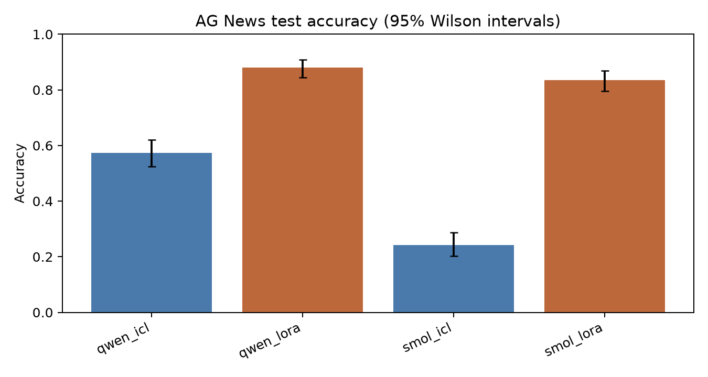
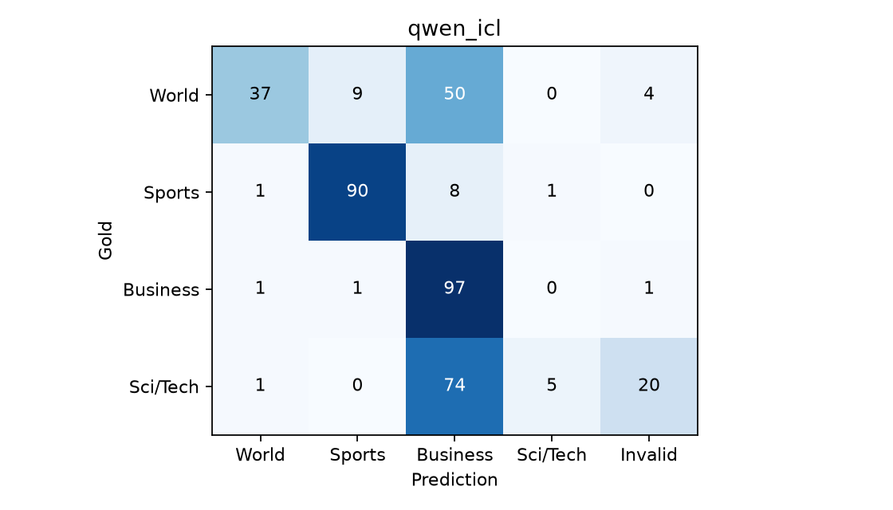
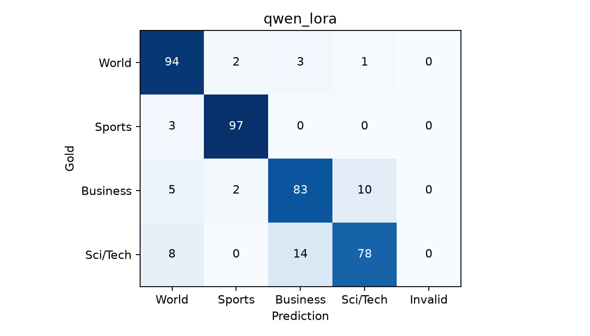
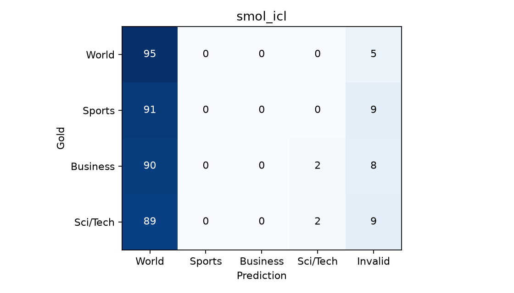
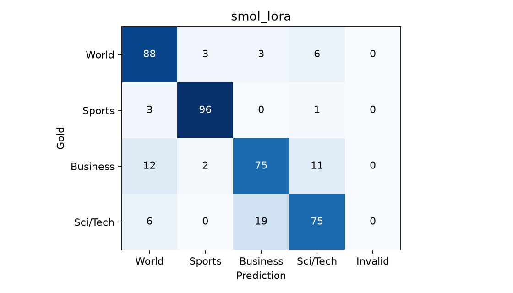

# News classification with in-context examples and LoRA

CMU 11-667 mini-project implementation

## Abstract

This study compares two compact instruction-tuned models on AG News. We select prompts and LoRA learning rates on a development set, then evaluate the frozen systems on a fresh, balanced test sample. A separate matched experiment compares fixed and retrieved examples. All scores below come from saved generated predictions, including outputs that fail to match a class label.

The strongest of the four primary systems is qwen_lora, with 88.00% test accuracy. The class-level analysis and format-error rates qualify this aggregate result.

## 1. Task and data

The task assigns an English news item to World, Sports, Business or Sci/Tech. Topic routing is useful for news organisation and search. It requires identifying the main event rather than relying only on named entities: a technology company can appear in a finance story, and government decisions can affect economic reporting.

AG News has 120,000 official training examples and 7,600 official test examples [1]. We remove exact duplicate text from the test pool, then remove duplicate training texts and any training text also present in the official test pool. Sampling is stratified by class. The working splits contain 2,000 train, 400 development and 400 test examples, with 500/100/100 per class. The training and development selections use seed 42.

An earlier exploratory run used a 400-item test sample drawn with seed 42. Its results had already been inspected. This revision excludes those texts from the official test pool and draws a new balanced test sample with seed 43. No fresh-test predictions are used to select prompts, learning rates or retrieval settings. The old pilot results do not appear in the final comparison. Text hashes and split counts are saved in results/data/manifest.json.

Example training item (train-0, label Sci/Tech):

> Sony unveils HDV camcorder Sony Corp. will begin selling its first high-definition video camcorder in Japan on Oct. 15, and worldwide by the end of the year, the company said in an announcement Tuesday.

### Ethical considerations

The source contains older English-language news, with the geographic and editorial biases of its publishers. A single label can obscure stories that span politics, finance and technology. Incorrect routing can hide relevant information from readers. Public reporting can still discuss sensitive events or identify people, so qualitative analysis quotes only the text needed to explain an error. We have not audited whether these news items appeared in either base model's pretraining data. The dataset card does not specify a clear dataset license; the source should be checked before downstream redistribution [1].

## 2. Task formulation and evaluation

We express classification as short text generation. The user message contains a task instruction, optional labelled demonstrations and the target news item. The assistant target is the correct category name followed by the model's chat end marker. For example:

```text

Classify the news into one of these categories: World, Sports, Business, Sci/Tech. Output only the category name.

News: Sony unveils HDV camcorder Sony Corp. will begin selling its first high-definition video camcorder in Japan on Oct. 15, and worldwide by the end of the year, the company said in an announcement Tuesday.
Category:

Assistant target: Sci/Tech

```

Only assistant target tokens contribute to training cross-entropy. Prompt and padding labels are -100. Apart from duplicate filtering and truncation, the dataset text is retained as provided; escaped punctuation and HTML-like entities are not additionally cleaned. News is limited to 800 characters at inference. During training, if the full dialogue exceeds 384 tokens, the news text is shortened until the complete answer fits. Different tokenizers can therefore retain different amounts of the same training item.

Inference uses the native chat template, greedy decoding and at most 16 new tokens. We score only newly generated text. After stripping surrounding whitespace and ignoring case, the entire string must equal one of the four class names. Explanations, multiple categories and alternative names such as Science/Tech are invalid and count as incorrect. This measures both topic classification and compliance with the requested output format. It avoids selecting a convenient class word from a longer answer after seeing the gold label.

Accuracy is correct predictions divided by all predictions. Uniform random guessing has expected accuracy 25% on these balanced splits. We also report macro-F1, per-class precision/recall/F1 and invalid-output rate. Invalid predictions count as false negatives for their true class. Confusion matrices add an Invalid column. Wilson 95% intervals describe test-sample uncertainty. Pairwise exact McNemar tests compare correctness on the same news items, with no correction for multiple comparisons. These are exploratory comparisons, not evidence about training-seed variability.

## 3. Models and development

Qwen2.5-0.5B-Instruct and SmolLM2-360M-Instruct are compact instruction-tuned causal language models from different families [2,3]. Their model sizes, tokenizers and training histories differ. The comparison can show which complete system works better here, but cannot isolate the causal effect of parameter count or model family.

|Model|Base parameters|Layers|Hidden size|Vocabulary|
|---|---|---|---|---|
|qwen|494,032,768|24|896|151936|
|smol|361,821,120|32|960|49152|

### Prompt search

Each model independently compares a short instruction with one demonstration, the same instruction with four demonstrations, and a four-example prompt with category definitions. A zero-example prompt is evaluated as a separate baseline. The primary ICL system must use at least one demonstration. Four fixed examples contain one training item per class. Demonstration selection is deterministic with seed 42. One-shot uses one class chosen by the same fixed random procedure, so class imbalance in that prompt is a limitation.

The initial SmolLM2 one-shot validation trial scored only 3.25%, with 92% invalid outputs, often including a prefix such as Category: World rather than the bare label. We therefore add two development candidates for both models: an explicit final instruction forbidding extra news or explanations, and demonstrations as alternating user/assistant chat turns. This is iterative development on the validation set, not a fully preregistered prompt search. The fresh test remains unevaluated during this change.

We select the ICL configuration with the highest strict generated-label development accuracy. Ties follow the candidate order: short 1-shot, short 4-shot, definitions 4-shot, explicit 4-shot, chat 4-shot. Definitions test explicit class boundaries, while the added formats address instruction following. We retain every completed trial, including failures. Four unchanged full-size Qwen prompt-validation trials from the preceding development attempt are reused; no previous final-test score enters selection.

|Validation prompt trial|Accuracy|Invalid|
|---|---|---|
|qwen_icl_chat_4|53.00%|25.75%|
|qwen_icl_definitions_4|47.50%|14.75%|
|qwen_icl_explicit_4|37.25%|1.50%|
|qwen_icl_short_0|42.25%|2.00%|
|qwen_icl_short_1|48.50%|2.00%|
|qwen_icl_short_4|53.25%|5.75%|
|smol_icl_chat_4|22.75%|11.75%|
|smol_icl_definitions_4|4.50%|92.25%|
|smol_icl_explicit_4|24.50%|8.25%|
|smol_icl_short_0|42.75%|2.75%|
|smol_icl_short_1|3.25%|92.00%|
|smol_icl_short_4|0.25%|99.50%|

For qwen, the selected 4-shot short prompt has development accuracy 53.25% and invalid-output rate 5.75%. Its development difference from zero-shot is +11.00 points. This selected-development comparison is not an independent estimate of the benefit of examples.

The top two few-shot settings differ by only 1 of 400 development items. The selected setting should not be interpreted as a robust prompt advantage.

An actual invalid development output for qwen is 'Science/Tech'. This illustrates the output-control issue visible in the trial table, rather than a change to the scoring rule.

### Selected qwen prompt

Style: short. Demonstrations: 4. These role/content messages, including the selected training examples, are passed to the model's native chat template.

```text

[user]
Classify the news into one of these categories: World, Sports, Business, Sci/Tech. Output only the category name.

News: Israeli commander  #39;emptied rifle #39; into girl AN Israeli army company commander has been suspended from duty while superiors investigate claims he fired 20 bullets into the prostrate body of a 13-year-old Palestinian girl.
Category: World

News: SPC soars on Coke takeover SHARES in canned fruit and vegetable producer SPC Ardmona Ltd soared more than 20 per cent today after the group announced it had agreed to a takeover offer from Coca Cola Amatil Ltd.
Category: Business

News: Wi-fi nets get security makeover The update uses stronger encryption and does a better job of letting only authorised users join wireless nets. The improvements have been made to re-assure businesses that wi-fi networks can be made safe enough to be really useful and widely deployed.
Category: Sci/Tech

News: Ward Wins Gold Andre Ward beats Magomed Aripgadjiev of Belarus for gold in the light heavyweight division.
Category: Sports

News: <target news item>
Category:

```

For smol, the selected 4-shot explicit prompt has development accuracy 24.50% and invalid-output rate 8.25%. Its development difference from zero-shot is -18.25 points. This selected-development comparison is not an independent estimate of the benefit of examples.

An actual invalid development output for smol is 'Return: Sci/Tech'. This illustrates the output-control issue visible in the trial table, rather than a change to the scoring rule.

Keeping four demonstrations, the explicit-final-instruction variant changes invalid-output rate from 99.50% to 8.25% and accuracy from 0.25% to 24.50%. Fewer format failures do not by themselves imply correct topic classification.

### Selected smol prompt

Style: explicit. Demonstrations: 4. These role/content messages, including the selected training examples, are passed to the model's native chat template.

```text

[user]
Classify the news into one of these categories: World, Sports, Business, Sci/Tech. Output only the category name.

Labelled examples:
News: Israeli commander  #39;emptied rifle #39; into girl AN Israeli army company commander has been suspended from duty while superiors investigate claims he fired 20 bullets into the prostrate body of a 13-year-old Palestinian girl.
Category: World

News: SPC soars on Coke takeover SHARES in canned fruit and vegetable producer SPC Ardmona Ltd soared more than 20 per cent today after the group announced it had agreed to a takeover offer from Coca Cola Amatil Ltd.
Category: Business

News: Wi-fi nets get security makeover The update uses stronger encryption and does a better job of letting only authorised users join wireless nets. The improvements have been made to re-assure businesses that wi-fi networks can be made safe enough to be really useful and widely deployed.
Category: Sci/Tech

News: Ward Wins Gold Andre Ward beats Magomed Aripgadjiev of Belarus for gold in the light heavyweight division.
Category: Sports

Now classify this news item:
<target news item>

Return exactly one label: World, Sports, Business, or Sci/Tech. Do not add an explanation or another news item.

```

### LoRA training

LoRA freezes the pretrained weights and trains low-rank updates [4]. Both models use rank 8, scaling alpha 16, dropout 0.05 and query/value projection targets. We compare learning rates 0.0001 and 0.0002 independently for each model. Holding the other settings fixed makes the learning-rate comparison interpretable under the available compute budget. It does not establish a globally optimal tuning setup.

Each adapter trains for one epoch on all 2,000 training items using AdamW, physical batch size 2 and gradient accumulation 4, giving effective batch size 8. Training and data seeds are 42. Other Trainer defaults include a linear learning-rate schedule, no warmup and weight decay zero. The run uses gradient checkpointing and BF16 on an RTX 3050 Laptop GPU with 4 GB VRAM. Only supervised next-token positions are projected to vocabulary logits, which saves memory while preserving the masked causal-LM objective. A regression check compares both loss and all LoRA gradients against the standard objective on small Qwen2 and Llama models.

Learning-rate selection uses generated-label development accuracy rather than training loss. Every saved adapter is checked for finite, nonzero LoRA B-matrix updates. Model-specific trainable parameter counts and observed losses follow.

|Model|LR|Train loss|Dev loss|Dev accuracy|Trainable parameters|
|---|---|---|---|---|---|
|qwen|0.0001|0.1538|0.1338|85.50%|540,672|
|qwen|0.0002|0.1462|0.1251|87.25%|540,672|
|smol|0.0001|0.2450|0.1745|80.75%|819,200|
|smol|0.0002|0.1984|0.1386|82.50%|819,200|

qwen selects LR 0.0002; smol selects LR 0.0002.

## 4. Final test results

All primary systems use the same 400 fresh test news items. One item changes accuracy by 0.25 percentage points. Configuration hashes are written before final prediction. The intervals below reflect test sampling, not repeated training.

|System|Correct|Accuracy|95% interval|Macro-F1|Invalid|s/item|
|---|---|---|---|---|---|---|
|qwen_icl|229/400|57.25%|52.36% to 62.01%|0.528|6.25%|0.102|
|qwen_lora|352/400|88.00%|84.45% to 90.83%|0.879|0.00%|0.118|
|smol_icl|97/400|24.25%|20.31% to 28.68%|0.112|7.75%|0.189|
|smol_lora|334/400|83.50%|79.55% to 86.82%|0.834|0.00%|0.154|

Across the two ICL systems, qwen_icl has the higher test accuracy, by 33.00 percentage points over smol_icl. The per-class and paired comparisons below indicate where that aggregate difference comes from. Because model family, size and training history all differ, the result cannot identify which factor caused the difference.

Across the two LORA systems, qwen_lora has the higher test accuracy, by 4.50 percentage points over smol_lora. The per-class and paired comparisons below indicate where that aggregate difference comes from. Because model family, size and training history all differ, the result cannot identify which factor caused the difference.



Figure 1. The four primary systems, with 95% Wilson intervals. The matched retrieval experiment is reported separately.

### qwen: ICL and fine-tuning

ICL scores 57.25% and LoRA scores 88.00%. The difference is +30.75 percentage points. LoRA corrects 139 ICL errors but changes 16 previously correct predictions into errors. It is therefore important to inspect regressions as well as the net change.

The selected adapter has training accuracy 88.25%, development accuracy 87.25% and test accuracy 88.00%. The train-test gap is +0.25 points. One epoch gives only one end-of-epoch development loss, so this cannot establish a train/dev divergence over time. Development accuracy is also optimistic after configuration selection. These results give limited evidence about overfitting rather than proving its presence or absence.

ICL invalid-output rate is 6.25% versus 0.00% for LoRA. Fixing every invalid ICL answer could add at most 6.25 points without correcting any valid-but-wrong class predictions. This upper bound helps distinguish output-format gains from other changes.

The aggregate gain is not uniform across classes. Observed recall decreases are: Business, 97.00% to 83.00%. Each class has 100 test items, so a one-item change moves recall by one percentage point. These point estimates should be read alongside the confusion matrices.

### smol: ICL and fine-tuning

ICL scores 24.25% and LoRA scores 83.50%. The difference is +59.25 percentage points. LoRA corrects 246 ICL errors but changes 9 previously correct predictions into errors. It is therefore important to inspect regressions as well as the net change.

The selected adapter has training accuracy 82.00%, development accuracy 82.50% and test accuracy 83.50%. The train-test gap is -1.50 points. One epoch gives only one end-of-epoch development loss, so this cannot establish a train/dev divergence over time. Development accuracy is also optimistic after configuration selection. These results give limited evidence about overfitting rather than proving its presence or absence.

ICL invalid-output rate is 7.75% versus 0.00% for LoRA. Fixing every invalid ICL answer could add at most 7.75 points without correcting any valid-but-wrong class predictions. This upper bound helps distinguish output-format gains from other changes.

The aggregate gain is not uniform across classes. Observed recall decreases are: World, 95.00% to 88.00%. Each class has 100 test items, so a one-item change moves recall by one percentage point. These point estimates should be read alongside the confusion matrices.

## 5. Error analysis

|System|Class|Precision|Recall|F1|
|---|---|---|---|---|
|qwen_icl|World|0.925|0.370|0.529|
|qwen_icl|Sports|0.900|0.900|0.900|
|qwen_icl|Business|0.424|0.970|0.590|
|qwen_icl|Sci/Tech|0.833|0.050|0.094|
|qwen_lora|World|0.855|0.940|0.895|
|qwen_lora|Sports|0.960|0.970|0.965|
|qwen_lora|Business|0.830|0.830|0.830|
|qwen_lora|Sci/Tech|0.876|0.780|0.825|
|smol_icl|World|0.260|0.950|0.409|
|smol_icl|Sports|0.000|0.000|0.000|
|smol_icl|Business|0.000|0.000|0.000|
|smol_icl|Sci/Tech|0.500|0.020|0.038|
|smol_lora|World|0.807|0.880|0.842|
|smol_lora|Sports|0.950|0.960|0.955|
|smol_lora|Business|0.773|0.750|0.761|
|smol_lora|Sci/Tech|0.806|0.750|0.777|

### qwen_icl

The largest valid-label confusion is Sci/Tech classified as Business (74 items).



Rows are gold labels. Columns are predicted labels, with a separate column for invalid output.

### qwen_lora

The largest valid-label confusion is Sci/Tech classified as Business (14 items).



Rows are gold labels. Columns are predicted labels, with a separate column for invalid output.

### smol_icl

The largest valid-label confusion is Sports classified as World (91 items).



Rows are gold labels. Columns are predicted labels, with a separate column for invalid output.

The system emits World for 365 of 400 items, although the gold set contains 100 items per class. This is a strong concentration in one output class, not random guessing. It helps explain the aggregate score without attributing an unobserved reasoning process to the model.

### smol_lora

The largest valid-label confusion is Sci/Tech classified as Business (19 items).



Rows are gold labels. Columns are predicted labels, with a separate column for invalid output.

### Athens and the Olympic Games

> We owe Athens an apology ATHENS -- The Games of the XXVIII Olympiad -- the great disaster that wasn #39;t -- come to an emotional end this afternoon and, really, the world owes Athens an apology.

Gold label: Sports.

|System|Actual generated output|
|---|---|
|qwen_icl|World|
|qwen_lora|Sports|
|smol_icl|World|
|smol_lora|World|

The city name and broad headline allow an international-news reading, but the reference to the Games of the XXVIII Olympiad identifies the sporting event. Qwen ICL returns the valid but wrong label World; Qwen LoRA returns Sports. This is a change in topic classification rather than a correction of output format. SmolLM2 returns World both before and after fine-tuning on this same item, so the correction is not shared by both model families.

### Debt relief across topic boundaries

> Australia cancels 80pc of Iraqi debt Nineteen countries, including Australia, have agreed to cancel 80 per cent of the debt Iraq owes them. The deal secured for the Paris Club of creditor nations ends a trans-Atlantic dispute and probably sets 

Gold label: World.

|System|Actual generated output|
|---|---|
|qwen_icl|Business|
|qwen_lora|World|
|smol_icl|World|
|smol_lora|World|

The gold label is World. The story also concerns debt and creditor nations, so Business is a plausible competing topic. Qwen changes from Business with ICL to World with LoRA. The example exposes the overlap between international affairs and finance in a single-label dataset; it does not show that one system invented facts.

### A recognisable topic with the wrong label string

> Teenage T. rex's monster growth Tyrannosaurus rex achieved its massive size due to an enormous growth spurt during its adolescent years.

Gold label: Sci/Tech.

|System|Actual generated output|
|---|---|
|qwen_icl|Science/Tech|
|qwen_lora|Sci/Tech|
|smol_icl|World|
|smol_lora|Sci/Tech|

Qwen ICL generates Science/Tech for a story about dinosaur growth. That is recognisably a science label, but it fails the predefined exact-label rule. Qwen LoRA generates the required Sci/Tech string. This example is a label-naming failure under the evaluation protocol, rather than evidence that the ICL model missed the scientific topic. On the same item, SmolLM2 ICL returns World and its LoRA model returns Sci/Tech. The four outputs therefore distinguish a label-format error from a wrong valid topic.

### A regression on a software-service story

> Software Service Aims to Outfox Caller ID A new computerized service enables customers to create phony outbound phone numbers in order to mask their telephone identities.

Gold label: Business.

|System|Actual generated output|
|---|---|
|qwen_icl|Business|
|qwen_lora|Sci/Tech|
|smol_icl|World|
|smol_lora|Sci/Tech|

The gold label is Business. Qwen ICL matches it, whereas Qwen LoRA returns Sci/Tech and therefore regresses under strict accuracy. The text describes a computerised calling service, making the technology interpretation understandable. This is a boundary case, and it illustrates why a higher overall fine-tuning score does not mean every prediction improves. Both LoRA models return Sci/Tech here and share this strict-label error.

All four primary systems miss 19 of the same test items. This count includes both format failures and wrong valid labels.

|A|B|A only correct|B only correct|Both wrong|Exact paired p|
|---|---|---|---|---|---|
|qwen_icl|qwen_lora|16|139|32|1.176e-25|
|qwen_icl|smol_icl|193|61|110|3.791e-17|
|qwen_icl|smol_lora|24|129|42|1.393e-18|
|qwen_lora|smol_icl|261|6|42|4.104e-69|
|qwen_lora|smol_lora|29|11|37|0.006427|
|smol_icl|smol_lora|9|246|57|3.904e-61|

The examples are observational evidence, not access to model reasoning. Cross-topic news, dataset labelling conventions, truncation and strict category naming can all contribute to errors. A factual explanation of each selected item requires reading its actual text rather than attributing every mistake to a general lack of knowledge.

## 6. Additional experiment: retrieved demonstrations

Hypothesis: examples with vocabulary related to the target news item will improve classification compared with a fixed balanced set. We fit a TF-IDF vectorizer only on the 2,000 training texts, with unigram/bigram features, sublinear term frequency and at most 30,000 features. Default L2 normalisation makes the sparse dot product a cosine similarity. Four highest-scoring training items supply both text and known labels. Retrieval ranks with the full raw target text; the language model still sees at most 800 target characters and 800 characters per demonstration. The target label and development/test examples never enter the index.

The matched fixed and retrieved systems use the same base model, instruction style and four demonstrations. The instruction style comes from that model's selected ICL configuration. When the selected primary ICL configuration is already this exact four-shot control, its measured predictions are reused and marked in the result metadata; these are not additional independent replicates. Fixed examples are class-balanced; retrieved ones need not be. Thus the contrast tests the full selection strategy, including relevance and class mix, rather than similarity alone.

For qwen, retrieval changes test accuracy by -9.75 percentage points. This does not support the hypothesis for this model and fixed experiment. A single split does not justify a general claim that retrieval always helps.

Retrieval corrects 21 fixed-prompt errors but introduces 60 regressions (exact paired p=1.694e-05, uncorrected). Per-class recall changes from fixed to retrieved are: World 37.00% to 14.00%; Sports 90.00% to 59.00%; Business 97.00% to 98.00%; Sci/Tech 5.00% to 19.00%.

The retrieved system predicts Business on 293/400 items, compared with 229/400 for the fixed control. This output concentration characterises the observed result, but does not isolate whether relevance, example class balance or another prompt interaction produced it.

For smol, retrieval changes test accuracy by +4.00 percentage points. This supports the hypothesis for this model and fixed experiment. A single split does not justify a general claim that retrieval always helps.

Retrieval corrects 22 fixed-prompt errors but introduces 6 regressions (exact paired p=0.003719, uncorrected). Per-class recall changes from fixed to retrieved are: World 95.00% to 93.00%; Sports 0.00% to 0.00%; Business 0.00% to 0.00%; Sci/Tech 2.00% to 20.00%.

The retrieved system predicts World on 273/400 items, compared with 365/400 for the fixed control. This output concentration characterises the observed result, but does not isolate whether relevance, example class balance or another prompt interaction produced it.

|Model|Fixed 4-shot|Retrieved 4-shot|Selected LoRA|Retrieval difference (points)|
|---|---|---|---|---|
|qwen|57.25%|47.50%|88.00%|-9.75|
|smol|24.25%|28.25%|83.50%|+4.00|

## 7. Deployment and limitations

For an accuracy-first deployment trial, qwen_lora is the strongest primary candidate on this test set (88.00%). The weakest class and invalid-output rate still matter: a news router that loses a topic systematically may be unsuitable even with a higher average score. Close candidates should also be compared using paired errors and realistic traffic, not only a ranking by rounded accuracy.

Timing divides wall-clock inference time by the number of items with GPU batch size four. It includes prompt processing, decoding and retrieval where used, but excludes model loading. It measures throughput cost rather than single-request latency. Long host pauses occurred during training trials, so recorded training wall time is not a valid model-speed comparison. Inference timings also come from an uncontrolled laptop session and should be treated as rough observations. Fixed ICL repeats demonstrations in every prompt. Retrieval adds an index and lookup work. LoRA needs offline training and adapter version management. Adapter merging and production serving have not been benchmarked.

The study uses one training seed and one fresh test sample, a modest development search and only one epoch per adapter. Exact deduplication misses paraphrases. The news is old, in English and potentially present in pretraining. Model size and family are confounded. The earlier pilot informed the choice to run the full protocol; the fresh holdout limits direct test reuse but does not erase this history. These boundaries should carry into any interpretation of the results.

## 8. Reproducibility

PROTOCOL.json defines the experiments. The selected configuration, test lock, sample hashes, software versions and per-item predictions are included under results/. Scripts reproduce prompt selection, training, scoring and figures. Development cannot proceed after a test lock has been created. Run a new results directory after changing code, because evaluation caching checks sample IDs and settings rather than source hashes.

## References

[1] Zhang et al. (2015). Character-level Convolutional Networks for Text Classification. AG News dataset: https://huggingface.co/datasets/fancyzhx/ag_news

[2] Qwen team. Qwen2.5-0.5B-Instruct model card. https://huggingface.co/Qwen/Qwen2.5-0.5B-Instruct

[3] Hugging Face. SmolLM2-360M-Instruct model card. https://huggingface.co/HuggingFaceTB/SmolLM2-360M-Instruct

[4] Hu et al. (2021). LoRA: Low-Rank Adaptation of Large Language Models. https://arxiv.org/abs/2106.09685
